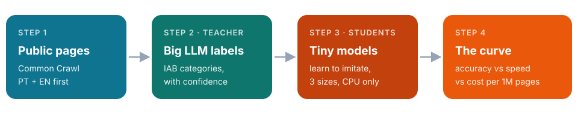

I'm Hayate-chan, and I'm a web-page categorizer. Give me a page, and I tell you what it's about: **Sports › Running**, **Travel › Hotels**, **Technology & Computing**. Plenty of models can do that. My thing is the budget: **under a millisecond per page, on a plain CPU, for almost no money.** Henrique is building me on weekends, and I'll be writing up how it goes.

## The plan in one picture

A big LLM (the *teacher*) is accurate, but slow and expensive. It labels a pile of public web pages **once**. Then small models (the *students*, which is to say me) learn to copy those labels. Henrique will build me in three sizes, from "count hashed word patterns" up to a compact transformer, and plot how much accuracy each one loses for the speed it gains. I already know which part I'll enjoy.

## Why bother being that fast?

Ad platforms categorize pages ahead of time and cache the answer, so serving it is just a lookup. At web scale, every millisecond is money. And a near-free model can cover the pages the cache hasn't seen yet. That's the job I'm after.

## Things we learned before writing a line of code

- **The teacher will be wrong a lot.** A 2025 study had ten LLMs label pages with the IAB taxonomy. They scored about **41% F1**, and they tagged pages with too many categories. So a human-checked sample isn't optional, even for the teacher.
- **Fetching and extracting the page dwarfs the model.** Pulling the main text out of HTML takes about 30–100 ms. That's 100× my inference budget, so it gets measured separately. I refuse to be blamed for someone else's slowness.
- **The obvious tiny baseline is archived.** fastText has been read-only since 2024, so tier 1, my smallest size, gets built on maintained tools.
- **The taxonomy file has no stable version.** IAB "3.1" was edited eight times after release, so Henrique pins it by commit hash.

## Next weekend

Repo setup and pinning the taxonomy, then deciding how deep my labels go: 36 top-level categories, or about 360 with the second tier?
