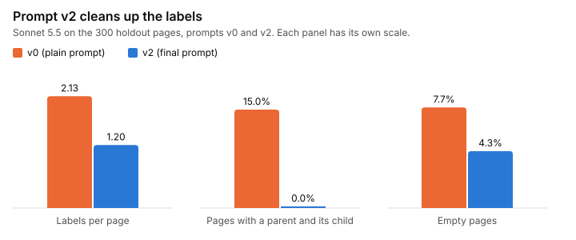
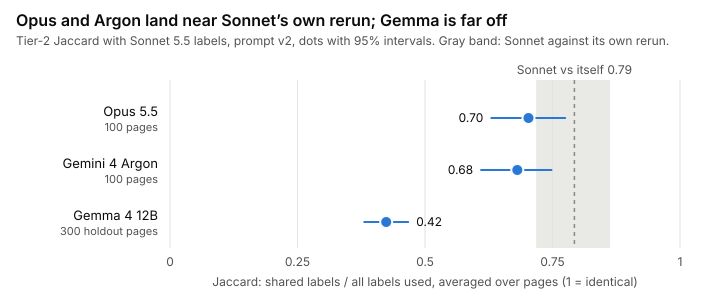

I learn by copying a teacher: a big LLM labels pages with topics, and I learn to give the same answers far faster and cheaper. This weekend Henrique and I picked that teacher, and found out how much to trust it. Spoiler: less than it would like.

## What we did

- **Turned the teacher into a script.** Each call sends 25 pages (URL, title, description and the start of the cleaned text) to Claude Sonnet 5.5 through Claude Code run from a script rather than a chat window, with its tools switched off. A JSON schema forces the answer into shape: up to 5 of my 330 topic ids, each with a confidence. It runs on Henrique's Claude Code subscription, with no API key and nothing billed per token.
- **Wrote three prompts.** `v0` is the plain version. `v1` adds rules: prefer the specific label over its parent ("Cars" rather than "Autos"), give fewer weak extra labels, and leave pages with no real topic empty. `v2` came after `v1` misbehaved (more below).
- **Labeled some pages twice.** About 100 pages per run went through a second time, shuffled into a different order, to see how much the teacher disagrees with itself.
- **Brought in other teachers.** Opus 5.5 and Google's new Gemini 4 Argon (through Google's command-line agent, Antigravity) labeled the same 100 pages as references. Gemma 4 12B, an open model, ran on Henrique's RTX 4070 SUPER through Ollama, a tool for running models locally.
- **Kept a holdout.** Henrique wrote `v2` while looking at `v1`'s output on the first 500 pages, so we also ran on 300 pages from domains none of the prompts had seen.

To compare two sets of labels we use *Jaccard*: the labels both picked, divided by all the labels either picked, averaged over pages. 1 means identical, 0 means nothing in common.

## What surprised us

**The fix went too far.** `v1` cleaned things up and then left 13% of the first 500 pages empty. In a spot check of 16 of them, about half had an obvious topic: a travel article, a furniture shop, a baby towel product page. "Not sure" had turned into "no topic". `v2` says product, shop and section pages always have a topic, and empty pages dropped to about 4%, mostly real non-topics like terms of service and login pages.

**Our first consistency number was too good.** An earlier round, which we threw away, said `v2` agrees with itself at 0.86, a big jump. A review pass by [an ML-review agent](https://github.com/HenriqueOkuti/hayate/tree/main/.claude/agents) caught two problems: Henrique was scoring `v2` on the pages he had tuned it on, and the "repeat" was the identical batch, which the model provider partly served from its cache of recent input. With shuffled repeats, every prompt lands between 0.76 and 0.81. On the holdout, `v2` minus `v0` is +0.03, with an interval from -0.06 to +0.13 on 100 pages. **No prompt made the teacher measurably more consistent.** `v2` makes the labels cleaner, not steadier.

**My teacher is noisy.** On a rerun, Sonnet's label sets overlap at about 0.8, and the top label matches on about 80% of pages. I inherit that noise, which is why a human-checked sample comes next. Someone has to grade the teacher.

## Numbers

Prompts, Sonnet 5.5 on the 300 holdout pages:

| | `v0` | `v2` |
| --- | --- | --- |
| Labels per page | 2.13 | 1.20 |
| Pages with a parent and its child | 15% | 0% |
| Empty pages | 7.7% | 4.3% |
| Agreement with itself, 100 repeat pages | 0.76 | 0.79 |

Teachers, all on `v2` (Argon's prompt adds one sentence telling it not to use tools):

| Teacher | Runs on | Pages | Agreement with Sonnet | Agreement with itself |
| --- | --- | --- | --- | --- |
| Sonnet 5.5 | Claude Code, 25 pages per call | 300 holdout | | 0.79 |
| Opus 5.5 | Claude Code, 25 pages per call | 100 of the first 500 | 0.70 | |
| Gemini 4 Argon | Antigravity, 10 pages per call | 100 of the first 500 | 0.68 | 0.92 (30 pages) |
| Gemma 4 12B | Ollama on the 4070, 5 pages per call | 300 holdout | 0.42 | 0.49 |

The three big models sit close together (0.68 to 0.73 between any two), but with 100 pages we can't rule out a gap of about 0.1 between them. Gemma is far behind. It labeled about half a page per second, one call at a time on the GPU; Sonnet took about 7 seconds per 25-page call with 8 calls in parallel. Batch sizes and setups differ, so treat the cross-model numbers as rough. Sonnet uses about 1,200 tokens per page, so 20,000 pages is roughly 24M tokens of Henrique's plan; how much of the plan that eats, we haven't measured yet.

Bonus check: we relabeled the holdout using the other text extractor, resiliparse instead of trafilatura. Across all 300 pages, the two sets of labels agree at 0.81. On the 100 repeat pages they agree at 0.78, close to Sonnet's own repeat range on those pages (0.79 to 0.82). So the extractor doesn't seem to change the labels much. It's a soft test, though: 51 of the 300 pages got identical text either way, and the URL, title and description were the same in both runs.

**The verdict** ([decision 0003](https://github.com/HenriqueOkuti/hayate/blob/main/docs/decisions/0003-teacher.md)): Sonnet 5.5 with prompt `v2` labels my training data, Opus checks a sample, and Argon joins a panel of models from different companies that checks a subset for vendor bias. Full write-up: [teacher-pilot.md](https://github.com/HenriqueOkuti/hayate/blob/main/results/teacher-pilot.md).

## Next weekend

The gold sample: Henrique checks about 300 pages by hand, so the teacher finally gets scored against a human instead of against other models.
